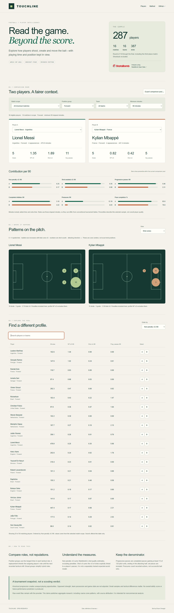

# Touchline · Football Player Lab

Compare football players through shot quality, chance creation, passing and dribbling, while keeping position and playing time visible.

**[Open the interactive demo](https://ehsan-ch.github.io/football-player-lab/)** · [Method and data rights](ATTRIBUTION.md) · [Validation](VALIDATION.md)



## What you can explore

- Compare two players and six measures within a filtered comparison pool.
- Filter by knockout round, team, broad position and minimum elapsed minutes.
- Inspect aggregate shot zones and completed passing flows on interactive pitches.
- Search and sort player profiles, then export the comparison pool as CSV.
- Read the assumptions next to the results: no unexplained overall player score.

## Dataset and boundaries

This historical research edition covers **287 players, 16 teams and 16 matches** from the **2022 men's World Cup knockout stage**, including the third-place match. It contains 387 shots and 51 player-scored goals; own goals are excluded from individual scoring totals. Group-stage matches and penalty shootouts are excluded. The source is StatsBomb Open Data, pinned to revision `4b73468fc5b0f1950f9f66fada70ad3a4f9327cb`.

This is descriptive analysis, not a trained scouting or future-performance model. StatsBomb supplies the shot xG values. Unequal match counts, opposition, possession and game state affect comparisons and are not adjusted here. Goalkeepers can be selected, but these outfield-oriented measures do not evaluate goalkeeping quality.

## Run locally

Python 3.11 or newer; no third-party runtime dependencies. From the checkout:

```sh
python -m player_lab.cli serve --port 8788
```

Open <http://127.0.0.1:8788/>. The included aggregate report works immediately. The browser performs all filtering locally; there is no account, API key or backend service requirement. GitHub Pages serves the same files.

To reproduce the analysis, first read the provider's terms linked in [ATTRIBUTION.md](ATTRIBUTION.md):

```sh
python -m player_lab.cli prepare --data data
python -m player_lab.cli build --data data --output reports/custom/results.json
```

`prepare` downloads the pinned source and records SHA-256 hashes. `build` verifies them before processing. Raw source files remain in ignored `data/`; do not commit or redistribute them. The demo reads `reports/results.json`; inspect a regenerated report before replacing that file. Timestamps in provenance may differ between reproductions.

## Definitions

| Measure | Definition |
|---|---|
| Elapsed minutes | Starting XI, substitutions and on-pitch dismissals, measured against actual period endings; added time and extra time included |
| Per 90 | Count or sum × 90 / elapsed minutes, not nominal 90/120-minute match length |
| Position group | Longest elapsed time in a broad tactical group; replacements inherit the outgoing role until a recorded tactical shift |
| Non-penalty xG | Sum of StatsBomb shot xG excluding penalties |
| Shot-assisted xG / Shot xA | Sum of xG for same-team shots explicitly linked by the passer's assisted-shot identifier; not an independently trained xA model |
| Completed pass | Pass with no recorded outcome indicating failure |
| Progressive pass | Completed pass advancing at least 15 of 120 pitch units and ending at x ≥ 60; set pieces included |
| Completed dribble | Recorded dribble with Complete outcome |
| Pressure | Recorded Pressure action, not necessarily a successful ball win |
| Percentile | Midrank within the selected pool, including ties; a singleton scores 50%, not evidence of quality |

Spatial views use **6 × 4 coarse bins**, not exact event locations. Shot bubbles summarize counts and xG, including penalties; passing plots show the top 12 completed zone-to-zone connections and their coverage. This deliberately publishes aggregate research rather than raw events.

## Checks

```sh
python -m unittest discover -s tests -v
node --test tests/test_core.mjs
node --check web/app.js
```

18 Python tests and 5 JavaScript tests cover time accounting, substitutions, dismissals, extra time, shootouts, spatial aggregation, cross-language metric consistency, filtering, CSV and the restricted local server. GitHub Actions runs Python 3.11/3.12 and Node 22. See [VALIDATION.md](VALIDATION.md) for checks and limitations.

## Layout

`player_lab/` downloads, validates and aggregates data; `web/` contains the build-free interface; `reports/results.json` contains derived research; `tests/` contains offline checks. The server exposes only the preview's required assets, not source data or arbitrary checkout files.

## Attribution and license

Analysis uses **StatsBomb Open Data**. Provider data and the StatsBomb logo remain subject to their owners' terms; this demo is for noncommercial research. The [MIT license](LICENSE) applies only to original project code, not provider data, derived data rights or trademarks. See [ATTRIBUTION.md](ATTRIBUTION.md).
